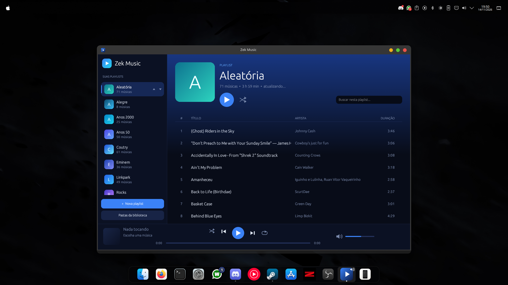

<div align="center">

# 🎵 Zek Music

**Player de músicas leve e moderno para Linux, onde cada pasta vira uma playlist.**




</div>

---

## ✨ O que é

O **Zek Music** é um player de músicas offline feito em **Rust**, pensado para quem organiza a biblioteca em pastas.
Você aponta para uma pasta e **cada subpasta com músicas vira uma playlist automaticamente**, com o nome da pasta.
Sem importar nada, sem banco de dados, sem conta: você organiza no gerenciador de arquivos e o player acompanha.

```
musicas/                 ← a pasta que você escolhe
├── Rocks/               → playlist "Rocks"
│   ├── música 1.mp3
│   └── música 2.mp3
├── Anos 2000/           → playlist "Anos 2000"
└── Eminem/              → playlist "Eminem"
```

## 🚀 Funcionalidades

- 📁 **Pastas viram playlists** — o nome da pasta é o nome da playlist (e você pode renomear depois)
- 🔄 **Biblioteca sempre atualizada** — a pasta é monitorada: adicionou ou removeu uma música, o player atualiza sozinho
- ✏️ **Renomear e reordenar playlists** — duplo clique para renomear, setinhas para mudar a ordem
- ➕ **Playlists personalizadas** — crie playlists fora do padrão, adicione músicas de qualquer pasta, arraste arquivos para a janela
- ▶️ **Player integrado** — play/pause, anterior, próxima, linha do tempo com arraste, volume, aleatório e repetir (tudo / uma)
- 🖼️ **Capa do álbum, artista e duração** lidos das tags dos arquivos
- 🔎 **Busca** dentro da playlist
- ⌨️ **Teclas de mídia (MPRIS)** — próxima, anterior e play/pause do teclado funcionam mesmo com o app em segundo plano ou dentro de um jogo
- 🎮 **Toca em segundo plano** — o áudio roda em thread própria e troca de música sozinho mesmo com a janela fechada ou minimizada
- 🛠️ **Tolerante com arquivos problemáticos** — MP3 com etiquetas ID3 fora do padrão ou "cortados" são recuperados automaticamente
- 🎨 **Visual moderno** em azul e escuro, simples e direto
- ⚡ **Leve e rápido** — binário nativo, abre quase instantaneamente; a biblioteca é lida em segundo plano

**Formatos suportados:** MP3, FLAC, OGG, WAV, M4A, AAC.

## 📦 Instalação

### AppImage (recomendado)

Baixe o `.AppImage` na aba [**Releases**](../../releases) e execute:

```bash
chmod +x ZekMusic-x86_64.AppImage
./ZekMusic-x86_64.AppImage
```

> No Fedora, se o AppImage reclamar de FUSE: `sudo dnf install fuse-libs`

### Compilar do código-fonte

**Dependências (Fedora):**

```bash
sudo dnf install gcc pkgconf-pkg-config alsa-lib-devel dbus-devel curl unzip fuse-libs
```

**Dependências (Debian/Ubuntu):**

```bash
sudo apt install build-essential pkg-config libasound2-dev libdbus-1-dev curl
```

Instale o [Rust](https://rustup.rs) e rode:

```bash
git clone https://github.com/ezekielso/zek-music.git
cd zek-music

cargo run --release        # compila e abre
./build-appimage.sh        # gera o ZekMusic-x86_64.AppImage
```

## 🕹️ Como usar

1. Na primeira abertura, clique em **Escolher pasta de músicas** e selecione a pasta que **contém** as suas pastas (ex.: `musicas`).
2. Cada subpasta aparece como uma playlist na lateral.
3. Clique numa música para tocar. **Espaço** = play/pause.
4. **Botão direito** numa playlist: renomear, mover, excluir (personalizadas) ou restaurar o nome da pasta.
5. **Botão direito** numa música: adicionar a uma playlist personalizada.
6. Em **Pastas da biblioteca** você adiciona, remove ou atualiza as pastas monitoradas.

As configurações (pastas, nomes e ordem das playlists, volume) ficam em `~/.config/zek-music/config.json`.

## 🧰 Tecnologias

| Parte | Tecnologia |
|---|---|
| Linguagem | Rust |
| Interface | [egui / eframe](https://github.com/emilk/egui) |
| Áudio | [rodio](https://github.com/RustAudio/rodio) + symphonia |
| Tags e capas | [lofty](https://github.com/Serial-ATA/lofty-rs) |
| Monitoramento de pastas | [notify](https://github.com/notify-rs/notify) |
| Teclas de mídia | [souvlaki](https://github.com/Sinono3/souvlaki) (MPRIS) |
| Empacotamento | AppImage |

## 🗺️ Ideias para o futuro

- [ ] Arrastar e soltar para reordenar playlists
- [ ] Fila de reprodução
- [ ] Equalizador
- [ ] Letras sincronizadas

## 📄 Licença

Defina a licença do projeto (por exemplo, MIT) adicionando um arquivo `LICENSE`.

---

<div align="center">
Feito com 💙 por <a href="https://github.com/ezekielso">ezekielso</a>
</div>
